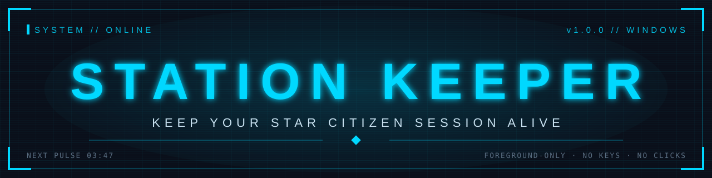
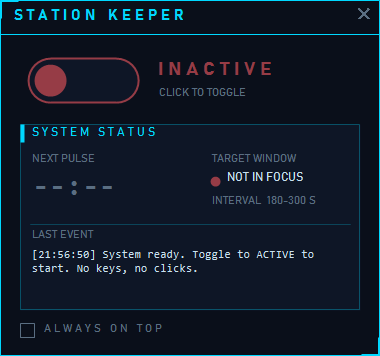
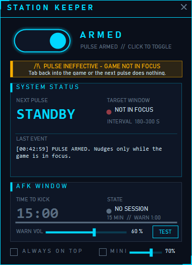

<div align="center">

# Station Keeper – Star Citizen AFK Timer & Idle-Kick Warning (Windows)



<br>


</div>


## ◢ OVERVIEW

**Station Keeper** is a free, open-source **Star Citizen AFK timer** for Windows. It shows how long you have before the game's idle kick (~15 min, community-reported) and plays a warning tone one minute before. With the **PULSE OFF** it sends **no keyboard or mouse input**. An optional anti-AFK mouse pulse can be armed **at your own risk**.

| Part | What it does | Sends input? |
|---|---|---|
| **AFK timer** | Counts down the game's idle-kick window and beeps when 1 minute is left. **Always runs**, no matter how the toggle is set. | **No** |
| **PULSE** (optional, top toggle **ARMED / OFF**) | Nudges the mouse 3 px and back at random intervals, only while Star Citizen is in the foreground. Off by default. | Yes, only when **ARMED** |

> [!WARNING]
> **The optional PULSE is at your own risk.** The [RSI Terms of Service](https://robertsspaceindustries.com/en/tos) prohibit users to *"Use or distribute auto software programs, macro software programs or other cheat utility software"*. Arming the PULSE may violate this and can lead to action against your account. By arming it, you accept that risk. With **PULSE OFF**, Station Keeper is a pure monitor that sends no input.

<div align="center">
  
  
  <br><sub>Left: AFK timer in monitor-only mode (PULSE OFF). Right: PULSE ARMED while the game is not in focus.</sub>
</div>

<sub>Unofficial fan project, not affiliated with Cloud Imperium Games / Roberts Space Industries. Star Citizen is a trademark of CIG.</sub>


## ◢ FEATURES

### AFK timer (always on, sends no input)

| | Feature | Details |
|---|---|---|
| ⏳ | **AFK window countdown** | Countdown of the game's idle-kick window (default 15 min, adjustable). **Always runs, independent of the PULSE toggle.** Starts after 1 min without input in the game, or immediately when you tab out. Turns amber at 3:00 and red at 1:00. |
| 🔔 | **Warning tone** | A short beep once per countdown when 1 minute is left. Volume slider (0–100 %) plus a **TEST** button, saved across restarts. |
| ▣ | **Always on top** | Optional checkbox, saved across restarts. |
| ⚙ | **Zero dependencies** | Single exe built with the .NET Framework compiler that ships with Windows. No installer, autostart, registry entries or admin rights. |

### Optional PULSE (off by default, at your own risk)

| | Feature | Details |
|---|---|---|
| ⏻ | **ARMED / OFF toggle** | Large HUD toggle that **only** switches the PULSE. The app always starts with **PULSE OFF**. |
| ↔ | **Minimal input** | Moves the mouse 3 px and back via Win32 `SendInput`. **No keys, no clicks.** |
| ◎ | **Foreground-only** | A nudge is only sent when the foreground window belongs to the `StarCitizen` process. |
| ⏱ | **Random interval** | 180–300 s by default, with a live countdown in the status panel. |
| ⚠ | **Pulse-ineffective warning** | While **ARMED** but the game is not in the foreground, a blinking banner shows amber **PULSE INEFFECTIVE - GAME NOT IN FOCUS** or red **GAME NOT RUNNING**. No sound. |


## ◢ MONITOR-ONLY MODE (PULSE OFF)

With the top toggle on **OFF**, Station Keeper sends **no keyboard or mouse input whatsoever**. It only reads which window is in the foreground and when your last input happened, then counts down Star Citizen's AFK window and plays the warning tone at 1:00.

This mode is meant for players who **want to stay within the RSI Terms of Service**, which prohibit auto and macro software. You still get a reminder to tab back in before the kick, and you make the input yourself.


## ◢ VERIFY THE DOWNLOAD

SHA256 of the assets in release **v1.2.0**:

| File | SHA256 |
|---|---|
| `StationKeeper.exe` | `0f5945ea13cd4be8be315121d1248e59cce33f224ef786f54d85a41aaa99a592` |
| `StationKeeper-v1.2.0.zip` | `319dca7ddc87b3b0577de6c73b31d4bf6551a6e825fc39abc4dfd4755a5133c5` |

Check them in PowerShell:

```powershell
Get-FileHash .\StationKeeper.exe -Algorithm SHA256
Get-FileHash .\StationKeeper-v1.2.0.zip -Algorithm SHA256
```

**VirusTotal:** [StationKeeper.exe](https://www.virustotal.com/gui/file/0f5945ea13cd4be8be315121d1248e59cce33f224ef786f54d85a41aaa99a592) · [StationKeeper-v1.2.0.zip](https://www.virustotal.com/gui/file/319dca7ddc87b3b0577de6c73b31d4bf6551a6e825fc39abc4dfd4755a5133c5). A few heuristic scanners flag the unsigned exe because it can send keyboard input (the optional PULSE). No major engine flags it. The full source is in this repo, so you can read it and build it yourself.

**SmartScreen:** the exe is not code-signed, so Windows may show "Windows protected your PC" on first launch. Click **More info > Run anyway**, or build it yourself.

**Build from source:** run `build.cmd`. It uses the C# compiler that ships with Windows, no SDK needed.


## ◢ BUILD

Requires Windows with .NET Framework 4.x, which is preinstalled on Windows 10/11.

```bat
build.cmd
```

The output is written to `bin\StationKeeper.exe`.


## ◢ USAGE

1. Run `StationKeeper.exe`.
2. Choose a mode with the top toggle:
   - **OFF** (default): monitor-only. No input is sent; just watch the AFK window countdown and listen for the warning tone.
   - **ARMED**: the PULSE is on. Switch to Star Citizen; the mouse is nudged only while the game is in focus.
3. If the PULSE is **ARMED** and you tab out (or the game is not running), a blinking warning banner tells you the next pulse will have no effect. Tab back into Star Citizen to clear it.
4. The AFK window countdown runs in both modes.
5. To quit, click **✕** in the top-right corner. You can drag the window anywhere.

```bat
StationKeeper.exe --min 120 --max 240
```

| Argument | Default | Description |
|---|---|---|
| `--min <seconds>` | `180` | Minimum interval between nudges |
| `--max <seconds>` | `300` | Maximum interval between nudges |


## ◢ CONFIGURATION

Settings are stored in:

```
%APPDATA%\StationKeeper\settings.ini
```

```ini
[StationKeeper]
AlwaysOnTop=0
WarningVolume=60
AfkTimeoutSeconds=900
AfkGraceSeconds=60
```

| Key | Default | Description |
|---|---|---|
| `AlwaysOnTop` | `0` | Keep the window above other windows |
| `WarningVolume` | `60` | Warning tone volume in percent (0 = muted) |
| `AfkTimeoutSeconds` | `900` | Length of Star Citizen's AFK window. 15 min is the value widely reported by players; CIG has not published an official number. |
| `AfkGraceSeconds` | `60` | Idle time in the game before the AFK countdown is shown |

### How the AFK timer counts

- The countdown always measures from your **last input while Star Citizen was in the foreground** (Win32 `GetLastInputInfo`).
- While you are in the game, it starts showing after 1 minute without input. When you tab out, it shows right away, still counting from your last input in the game.
- Any input in the game resets it. Station Keeper's own nudges are real mouse input to the game, so when the PULSE is **ARMED** and the game is in focus they keep resetting the timer, and the state shows **HELD BY PULSE**. When you tab out, no nudges are sent and the countdown runs normally.

> [!NOTE]
> - **Always on top** cannot overlay the game in exclusive fullscreen. Use the *Borderless* window mode.
> - If Star Citizen runs as administrator, Station Keeper must run as administrator too. Otherwise Windows blocks the input.
> - The executable is unsigned, so Windows SmartScreen or Defender may warn on first launch (see *Verify the download*).


## ◢ DISCLAIMER

> [!WARNING]
> **The [RSI Terms of Service](https://robertsspaceindustries.com/en/tos) prohibit users to "Use or distribute auto software programs, macro software programs or other cheat utility software".** Using the **PULSE (ARMED)** may violate those terms and can result in action against your account. **Use it entirely at your own risk; by arming it you accept that risk.** The AFK timer alone sends no input. The authors accept no liability.

This is an unofficial fan project. It is not affiliated with, endorsed by or sponsored by Cloud Imperium Games or Roberts Space Industries. Star Citizen®, Roberts Space Industries® and Cloud Imperium® are trademarks of Cloud Imperium Rights LLC. No game assets are used.


<div align="center">

**[MIT License](LICENSE)** · Made by **FrittenFritz**

<sub>STATION KEEPER // v1.2.0</sub>

</div>
